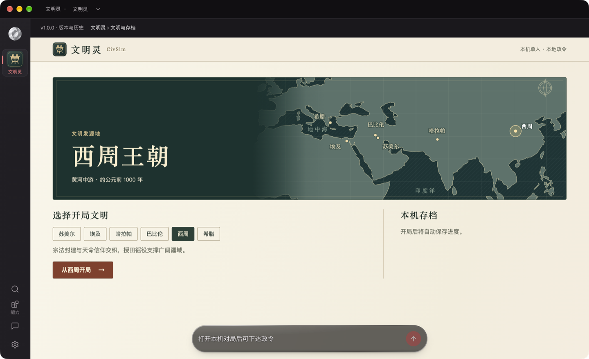
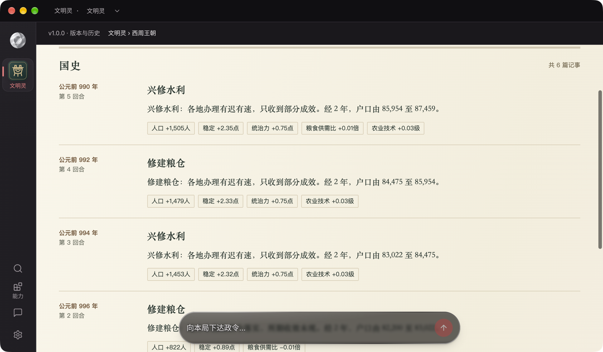
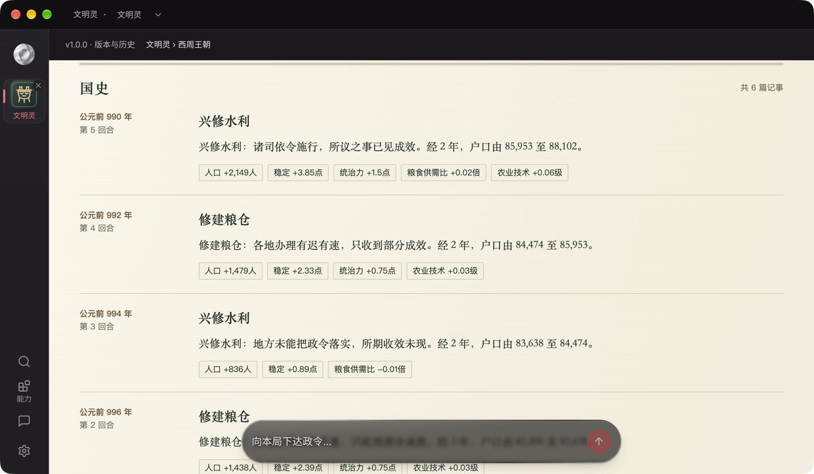

# 文明灵在万相的桌面验收

2026-11-17 使用 macOS 27.2.1 arm64、Python 3.12.15、Node 22.12.0、Electron 43.1.1 和 Playwright 1.61.1。游戏功能提交为 `b5f8a7749b0e764c386cb5e60cfdaa338840351c`。配套的[万相宿主提交](https://github.com/SoProStars/omniagent/commit/4f7771e75af473515cd6fcf9fb3f188f4db78dab)提供了独立应用视图、项目隔离的游戏桥、左栏应用切换和关闭、悬浮玻璃输入框。

| 检查 | 结果 |
| --- | --- |
| Python 完整测试 | 166 项通过。FastAPI 测试客户端报告一条 Starlette 与 httpx 的依赖弃用提示。覆盖重复政令回放、过期回合拒绝、并发结算和恢复最近打开的存档。 |
| Vue 独立生产构建 | Vite 5.4.21 生成五个静态文件，逐文件比较与用于桌面测试的安装包内容一致。 |
| 首局与底部输入框 | 在真实窗口安装、打开文明灵并选西周。「希望四海升平」触发澄清，仍是第 0 回合。「兴修水利」进入第 1 回合。「问史官」基于已保存国史作答，仍是第 1 回合。 |
| 应用切换、关闭与恢复 | 回首页后从左栏切回游戏，回合和纪事保持一致。在游戏图标上悬停并单击淡色叉，左栏入口消失，首页图标仍可打开。重开游戏并逐字核对原史文，再完全退出万相后重启，读取同一回合并以「修建粮仓」进入第 2 回合。 |
| 跨进程玻璃与鼠标 | 游戏视图下沿与窗口下沿相差不超过 1 CSS px。测试在独立游戏页面临时放置红蓝色带，用真实鼠标在胶囊侧边滚动、点击，点击命中游戏。macOS 只捕获测试窗口。玻璃内部采样的红减蓝均值从 +81 变为 −88，框外参考从约 +183 变为 −201，胶囊位置保持固定。 |

### 实机画面







以上图片均来自真实 macOS 窗口及临时离线对局。最后一张取自配套宿主同版本的独立试玩存档。

构建环境和启动步骤见[桌面开发指南](../../../omniphase-tools/README.md)。重跑桌面检查时指定一个截图目录即可保留本轮真实窗口，例如：

```sh
node omniphase-tools/check-desktop.mjs "$OMNIPHASE_REPO" ./local-evidence
```

脚本每轮都创建独立的临时万相资料目录和本地存档。演示中的年份、人口及政令成效由本次存档的初始种子决定。可复现的判据是同一存档的回合、史文及其重开后的连续性。可选模型的恢复逻辑通过固定响应验证，桌面实测使用默认离线模式。
